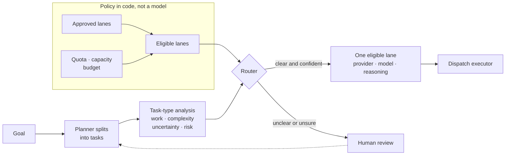

# How a planned task gets a model

A planner turns a goal into tasks. Each task still needs an executor: a provider, a model, and a reasoning level. Send everything to the strongest model and you burn budget and quota; send everything to the cheapest and you pay in rework. That choice is made hundreds of times a day, it's bounded (a small set of approved lanes), and its mistakes are cheap to detect but expensive to repeat. That makes it a good fit for fast, typed decisions — if they can be trusted.

Router candidates in this experiment: the current Workbench planner (baseline), a typed decisions API (Gemini Decision 1), and ordinary LLMs with a JSON schema (Claude, GPT-6 Luna).

The model never grants permission. Code removes lanes that are unapproved, out of quota or over budget before any router sees the task, so the worst a router can do is pick a poor *allowed* lane or ask for review. That's what the experiment measures: who picks the cheapest adequate lane, and who knows when to stop and ask.
